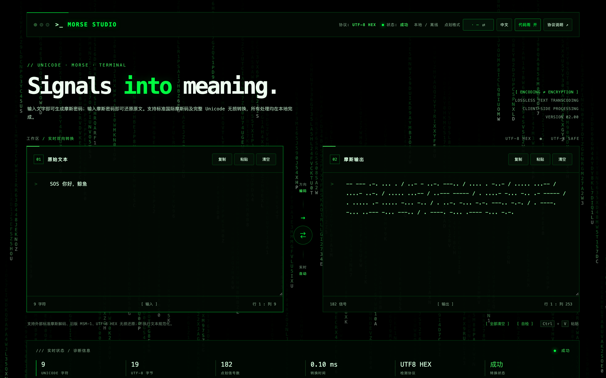

# Morse Studio

> **Signals into meaning.** — 一个单文件、零依赖、完全离线的摩斯密码终端。
>
> 键入文字即得摩斯码，粘贴摩斯码即还原原文。支持标准国际摩斯码与完整 Unicode 无损往返，所有运算都在浏览器本地完成，没有请求、没有上传、没有构建步骤。



---

## 这是什么

`index.html` 就是整个应用——HTML、CSS、JavaScript 全部内联在一个约 70 KB 的文件里，不依赖任何 CDN、字体或框架。双击打开即用，断网也能跑；丢进 U 盘、发给自己、放到任意静态托管上都行。

界面是深色终端风格，带可开关的代码雨背景、中英双语切换和实时诊断面板。

## 功能

- **双向实时转换**：左侧输入原文 → 右侧生成摩斯码；反过来粘贴摩斯码 → 左侧还原文本。方向自动识别。
- **完整 Unicode**：ASCII 走标准直编路径；中文、emoji 等走 UTF-8 HEX 无损通道，还原后与原文逐字节一致。
- **两种点划显示**：经典 `.` `-`，或数字模式 `0` `1`，一键切换。
- **无损保证**：不做任何文本规范化（不折叠空白、不转换全半角、不改大小写），输入什么就还原什么。
- **实时诊断**：字符数、UTF-8 字节数、点划信号数、转换耗时（毫秒）、检测到的协议、转换状态。
- **内置自检**：点击「自检」在页面内跑 25 条编解码断言，覆盖 ASCII、Unicode、emoji、非法输入等边界。
- **兼容旧版**：可解码外部标准摩斯码、旧版 `MSM-1` 线路格式与旧的 `MSM2 UTF8 HEX` 头。
- **离线 & 隐私**：纯客户端处理，剪贴板操作走浏览器 Clipboard API，不监听输入内容。

## 快速开始

**方式一：直接打开**

```bash
git clone https://github.com/DUGU-SHUANGTAN/morse-studio.git
open morse-studio/index.html      # macOS
# 或把 index.html 拖进任意浏览器
```

**方式二：GitHub Pages**

仓库根目录已就位 `index.html`，在 Settings → Pages 里选 `main` 分支根目录即可，无需构建。

## 编码格式

摩斯码本身只能表达字母、数字和少量标点——它装不下中文、emoji 和大小写。要做到「输入什么就还原什么」，就必须在密文里携带元信息。

Morse Studio 采用**自描述中间格式**，而不是需要额外学习一套控制串的私有协议：

```
MORSE UTF8 HEX E4BDA0 E5A5BD
```

- 协议头 `MORSE UTF8 HEX` 声明后面跟的是十六进制字节。
- 每个字节是一组标准摩斯码，空格分隔。
- 解码端看到头部，就知道该按 UTF-8 还原成文本。

**大写** ASCII——`A-Z`、`0-9`、空格与常用标点——走最短路径，一个字符就是一个摩斯码，不加头部、不加字节。所以 `SOS` 输出就是三个字符 `... --- ...`，`HELLO 123` 就是标准国际摩斯码，任何第三方解码器都能读。

一旦出现小写字母、中文或 emoji，就需要携带额外信息（大小写本身也是信息），此时自动切到 UTF8 HEX 通道，诊断面板的「检测协议」也会同步从 `ITU / STANDARD` 变成 `UTF8 HEX`。

为什么不直接编码成 Base32 或二进制？因为那样产出的密文人类不可读，也失去了「摩斯码」本身的意义。UTF-8 HEX 的长度是可控的，而且每一段都还是能被人用耳朵听、用手抄的点和划。

### 兼容边界

| 场景 | 支持 |
| --- | --- |
| 标准国际摩斯码 ↔ 大写 ASCII / 数字 / 标点 | ✅ 双向，输出即标准摩斯码 |
| 小写字母、混合大小写 | ✅ 双向，走 UTF8 HEX 通道 |
| 完整 Unicode（中文 / emoji / 组合字符） | ✅ 双向，逐字节一致 |
| 旧版 `MSM-1` 线路格式（`MSM1 ` 前缀） | ✅ 仅解码 |
| 旧版 `MSM2 UTF8 HEX` 头 | ✅ 仅解码 |
| 孤立代理项（非法 UTF-16） | ❌ 显式拒绝并报错 |
| 文本规范化（全半角、空白折叠） | ❌ 刻意不做，保证无损 |

## 文件结构

```
morse-studio/
├── index.html        # 整个应用（约 70 KB，零依赖）
├── docs/
│   └── screenshot.png
├── LICENSE
└── README.md
```

没有 `package.json`，没有构建脚本，没有 `node_modules`。改一行刷新一次就能看到效果。

## 自检

页头右上角「自检」按钮会当场跑完整测试集：ASCII 往返、Unicode 往返、emoji、超长输入、非法十六进制、孤立代理项、旧格式兼容……全部断言通过才会显示绿色的 `成功`。

命令行验证也可以直接打开页面后看诊断面板的「转换状态」一栏。

## English

**Morse Studio** is a single-file, zero-dependency, fully offline Morse code terminal. Type text and get Morse; paste Morse and get the text back. Standard ASCII goes through the classic direct path, so plain English output stays compatible with any third-party Morse decoder. Everything else travels as `MORSE UTF8 HEX` — a self-describing intermediate format that carries UTF-8 bytes as Morse groups — which makes the round-trip lossless for Chinese, emoji, and mixed scripts. No normalization is applied, so what you typed is exactly what you get back. A built-in self-test runs 25 assertions in the page. Open `index.html` and it just works.

## License

[MIT](LICENSE) © 2026 DUGU-SHUANGTAN
